FP Launchpad's charter puts [systems and community]() alongside research and teaching. This post covers the community events we took part in between September and November.

- At [IndiaFOSS 2026](https://fossunited.org/indiafoss/2026) in Bengaluru, we ran a three-hour [OCaml workshop](https://fplaunchpad.org/indiafoss-2026-ocaml-workshop/) and gave four talks.
- At [Innovations in Compiler Technology (IICT) 2026](https://compilertech.org/), nine of us attended, Pragyansh presented the OCaml–MMTk work, and the organisers estimated the team spoke to more than **200 people** at our booth on the first day.
- We sponsored two student hackathons: [SEGFAULT](https://segfault.compilertech.org/), where we funded the prizes for the two teams sharing third place, and [Syntax Error](https://hackathon.sdslabs.co/) at IIT Roorkee, which ran a functional programming track with us as Gold sponsor.
- Three of the team went to the [Healing Earth workshop](https://3cs.ashoka.edu.in/healing-earth-workshop) on climate science and policy at Ashoka University, and three submitted proposals to [SciPy India 2026](https://scipy.in/), as we look for ways to contribute to scientific computing.
- We are hosting [FUN OCaml](https://fun-ocaml.com/) in Bengaluru on 25–26 January 2027, and applications for the [Post-Baccalaureate Fellowship, Cohort 2]() close on **10 December**.

<strong>In this post:</strong> <a href="#indiafoss-2026">IndiaFOSS</a> (<a href="#the-workshop">workshop</a>, <a href="#the-talks">talks</a>) · <a href="#iict-2026">IICT</a> · <a href="#two-hackathons">Hackathons</a> (<a href="#segfault">SEGFAULT</a>, <a href="#syntax-error">Syntax Error</a>) · <a href="#software-for-science">Software for science</a> (<a href="#healing-earth">Healing Earth</a>, <a href="#scipy-india">SciPy</a>) · <a href="#joining-fp-launchpad">Joining FP Launchpad</a> · <a href="#looking-ahead">Looking ahead</a>

## IndiaFOSS 2026

[IndiaFOSS](https://fossunited.org/indiafoss/2026), run by [FOSS United](https://fossunited.org/), is India's largest free and open-source software conference. It was held at the NIMHANS Convention Centre in Bengaluru from 25 to 27 September. The [September update](/blog/2026-09-fp-launchpad-update/) previewed our sessions.

Nine of us attended: [KC Sivaramakrishnan](https://kcsrk.info) (Faculty), [Alina Banerjee](https://www.blue-indus.in/) (Research Staff), [Navaneeth Nambiar](https://www.linkedin.com/in/navaneeth-nambiar/) (Research Staff), [Vimala Soundarapandian](https://sites.google.com/view/vimala90/) (Research Scientist), [Durwasa Chakraborty](https://durwasa-chakraborty.github.io) (PhD student), [Pragyansh Chaturvedi](https://people.ubuntu.com/~r41k0u/portfolio/) (Fellow), [Smayan Agarwal](https://github.com/SmayanAgarwal) (Fellow), [Kaustubh M](https://kaustubh.page) (Fellow) and [Anirudh Sudhir](https://www.linkedin.com/in/anirudhsudhir/) (Intern).

We ran one workshop and gave four talks: one on the main track and three in the Compilers, Programming Languages and Systems devroom.

### The workshop

Alina led [Fun and Profit with OCaml](https://fossunited.org/c/indiafoss/2026/cfp/699fhigvkl) on 25 September, with Vimala, Kaustubh and Smayan. It was a three-hour beginner session built on the runnable examples of our [interactive OCaml textbook](https://fplaunchpad.org/ocaml_nptel/), so participants wrote OCaml in the browser without installing anything. The final part was open-ended: participants could build [Tic-Tac-Toe](https://fplaunchpad.org/indiafoss-2026-ocaml-workshop/04-tic-tac-toe.html), Smayan's [Game of Life](https://fplaunchpad.org/indiafoss-2026-ocaml-workshop/05-game-of-life.html), or draw pictures with [OCaml Joy](https://fplaunchpad.org/indiafoss-2026-ocaml-workshop/06-joy.html). The [material is open](https://github.com/fplaunchpad/indiafoss-2026-ocaml-workshop) for anyone who wants to reuse it.

The room was mixed: roughly a third already knew a functional language, and close to half had never used one. Two of the instructors wrote about the day.

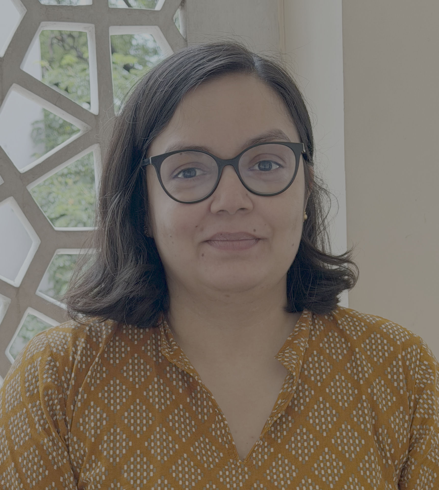 Alina

> The online notebooks were crucial to things going smoother than they would have with individuals setting up the OCaml platform on their own computers.
>
> Post workshop:
>
> About a third of the attendees were aware of FP Launchpad and were very interested in the work that we do. Some of them expressed their keen interest in applying for the upcoming cohort for FPL fellows.
>
> Takeaways:
>
> Tie in what we teach to other exciting parts of part/adjacent areas - type theory, logic etc. so that people from various backgrounds go back and think of the language/paradigm as something that comes from a mix of very rich areas of research and experimentation.

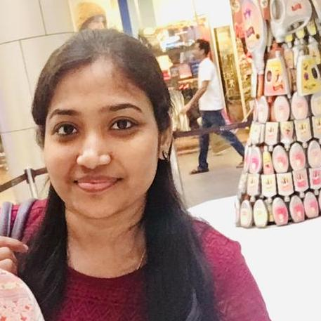 Vimala

> Alina, Kaustubh, Smayan, and I conducted a workshop titled "Fun and Profit with OCaml" at IndiaFOSS 2026. This was my first time conducting a workshop, so we made sure to prepare the material well beforehand. The workshop had a mix of students and people from the industry. My part was to teach OCaml's data types and pattern matching, which are important concepts for understanding many of the topics that follow.
>
> The first half, covering variants, records, tuples, pattern matching, and exhaustiveness checking, went well. However, due to lack of time, I had to rush through parameterised types and recursive data structures. While explaining these concepts, I realised that instead of directly introducing a data type and its syntax, I should have started with a practical use case and then explained how the data type helps solve the problem. This would have helped participants better understand where and why these concepts are useful. I also found that comparing these concepts with features from other languages could have helped, especially when explaining option types. Some participants found it a little difficult to understand the use case of option types. I'll keep these in mind for future workshops and teaching in general.
>
> Overall, the participants seemed to enjoy the workshop and found it useful, and my other team members did a great job as well. We could have reduced the amount of content slightly to leave more time for the games at the end, which were one of the most interesting parts of the workshop. One of the students who attended the workshop later met me at the IICT conference and mentioned that she enjoyed the workshop and was interested in applying for the Post-Bacc Fellowship at FP Launchpad. Overall, it was a great experience, and I hope to learn from these lessons and make my next workshop even better.

When the team met to review the workshop, the broadest complaint from participants was simple: we covered too much. For the next run, we will cut content, split beginners from people who already know a functional language, rework the most convoluted exercise (a nested pattern match that confused even experienced programmers), and collect contact details so participants can hear about future events.

### The talks

On the main track on 26 September, KC gave [Textbooks that run](https://www.youtube.com/watch?v=2KjUZ5HFSeI&t=4564s), on the interactive, zero-install textbook behind our [NPTEL course](https://onlinecourses.nptel.ac.in/e-learning/course/noc26_cs90) and the workshop. The textbook and its in-browser runtime are open ([ocaml_nptel](https://github.com/fplaunchpad/ocaml_nptel), [ocaml-browser-vm](https://github.com/fplaunchpad/ocaml-browser-vm)), and KC describes the approach in [An O(x)Caml book that runs](https://kcsrk.info/ocaml/oxcaml/teaching/nptel/llm/2026/06/13/an-oxcaml-book-that-runs/). That afternoon, three of the team spoke in the [Compilers, Programming Languages and Systems devroom](https://fossunited.org/indiafoss/2026/devrooms/compilers) ([recording](https://www.youtube.com/watch?v=rb1ZALRGFjw)), organised by [Ashutosh Pandey](https://www.linkedin.com/in/ashupdsce/):

- Navaneeth on why [benchmarking can be hard, and why we are still building a new benchmark for OCaml](https://fossunited.org/c/indiafoss/2026/cfp/6aasju7noq). Code: [retro-httpaf-bench](https://github.com/fplaunchpad/retro-httpaf-bench), and Sanjeev's [Ocaml-Bench-Research](https://github.com/Mr-Daker/Ocaml-Bench-Research) and [Ocaml-Benchmark-analysis](https://github.com/Mr-Daker/Ocaml-Benchmark-analysis). Navaneeth gave an earlier seminar, [Benchmarking on Modern Hardware](/updates/#talk-benchmarking-on-modern-hardware).
- Pragyansh, with Varun Mallya, on [PythonBPF](https://fossunited.org/c/indiafoss/2026/cfp/299lpkmuqh), which lets developers write Linux kernel programs in a subset of Python, now with loops, custom functions and more map types. Code: [Python-BPF](https://github.com/pythonbpf/Python-BPF), which you can also try in the browser with [pythonbpf-playground](https://github.com/pythonbpf/pythonbpf-playground). Pragyansh's earlier seminar, [Making Sense of eBPF](/updates/#talk-making-sense-of-ebpf), covers the kernel side ([ebpf_gen](https://github.com/fplaunchpad/ebpf_gen)).
- Durwasa on why [LGTM Is Not A Theorem](https://www.youtube.com/watch?v=rb1ZALRGFjw&t=7348s) ([slides](https://anachronisticmonk.github.io/indiafoss/deck.html)).

<figure style="margin:1.5em 0;">
  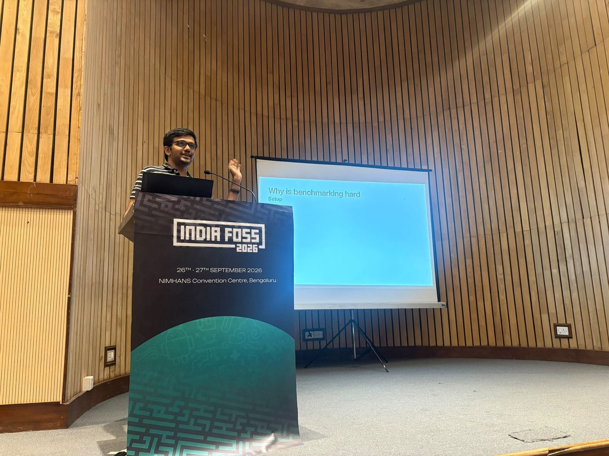
  <figcaption style="font-size:0.9em;color:#666;margin-top:0.4em;">Navaneeth explains why benchmarking is hard, in the Compilers, Programming Languages and Systems devroom.</figcaption>
</figure>

Durwasa has since written a longer post, [From "Kundalahalli Is Not Kundalahalli Gate" to "LGTM Is Not a Theorem"](https://durwasa-chakraborty.github.io/posts/a-return-to-bangalore-for-indiafoss/).

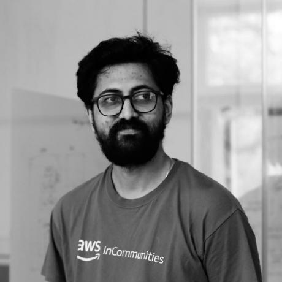 Durwasa

> In 2015, I attended PyCon India at the same venue - NIMHANS; it was my first real exposure to the idea that you don't need to be from an IIT to contribute to open source. That sounds naive now, but at the Govt. Engineering College Jabalpur, most of us had missed out in JEE and believed the only way to redeem ourselves was a great GATE rank. The idea of making our engineering lives better didn't cross our minds until we visited PyCon. So presenting a fairly technical talk at that same venue years later brought me a lot of joy.
>
> Many students wanted to know more about my area of work. I was really surprised that a couple of students read my article, [How LLMs ~almost~ destroyed my career](https://durwasa-chakraborty.github.io/posts/how-agentic-llms-almost-destroyed-my-academic-career/), and shared it in their college group. I really did not expect that.
>
> I was accompanied by my friend from Engineering college who is now a founding engineer of a startup in Bangalore, but I ran into many familiar faces: seniors, friends from the Bangalore circuit.
>
> There was a lot of interest in hardware; for builders (and I count myself among them), tinkering with hardware is one of the few things that still feels a bit organic - echoing the same sentiment my friend had, who has built a career in software engineering but realizes that we are mostly prompting right now. I hope to build a music player or keyboard from scratch (as in the microcontroller and above). For now, at least for a year, they remain on the back burner.
>
> Almost every talk had some AI angle or buzz around it.
>
> I really enjoyed Prof. KC's talk (my friends who were attending were discussing the next day about running lightweight VMs in browsers. Some other talks, on WASM and on compiling X to Y, ran into the same underlying problem. I really loved the idea that books should evolve; that should be the only point of making books digital, we can dive deep into topics we want, and the book should provide an interface for it.
>
> I liked Ansh Arora and [Kailash Nadh](https://nadh.in/)'s talk. It addressed some pressing issues especially the junior hiring issues had very good and pragmatic solutions.
>
> [Rukmini S on Data Journalism](https://www.youtube.com/watch?v=bXMjp1JOzPQ&t=7085s) was very informative, shes is a Chennai-based journalist and the author of Whole Numbers and Half Truths. Statistics can easily be used to hide the truth and that is something I personally care about deeply.
>
> Prof. [Mohit Tahiliani](https://www.linkedin.com/in/mohittahiliani)'s talk was my favorite talk. I strongly share his view that the open source revolution and really the free software revolution should be taken forward by India and Indians. I asked him how his course project avoids Hacktoberfest-style PR spam, since students are rewarded for opening PRs. He kindly explained the two-tier strategy he uses to keep NIT K's name from being diluted.

### Projects we noticed

The team kept a shared channel of notes during the conference. A few projects we want to follow up on:

- [Zasper](https://zasper.io/), a Jupyter server written in Go that speaks the Jupyter protocol and is faster than JupyterLab. Navaneeth plans to try it for the OCaml benchmarking work.
- [OHC CARE](https://ohc.network/product/care-core), an open-source healthcare platform ([talk](https://fossunited.org/c/indiafoss/2026/cfp/062rh0sg2r)). KC's first question was how one might verify its security properties.
- [Bharat Digital](https://www.bharatdigital.io/), Harsh Nisar's team, which works with governments, nonprofits and community organisations on technology for social good, and had a booth.
- [Servants of Knowledge](https://archive.org/details/ServantsOfKnowledge), which is digitising the Mysore Palace archive to the Internet Archive with better search metadata, using their tool [Repub](https://github.com/ServantsOfKnowledge/repub). The same project covers literature in coastal Karnataka languages: Beary Bashe, Tulu-influenced Arebhashe and Konkani.
- [diagramchasing.fun](https://diagramchasing.fun/), which turns raw government data, such as IMD weather data published as images, into something readable. Anirudh flagged it for our climate work.
- [Redkill](https://redkill.in/), an open-source, safety-critical, formally verified real-time operating system.
- [Package URL](https://packageurl.org/), a specification that makes it possible to track vulnerabilities at the package level.

Alina noted a remark by Lokesh Chellaiya: being told to start on an open-source project through issues tagged "good first issue" felt like "being left blindfolded in a forest".

## IICT 2026

A week later, nine of us were at [IICT 2026](https://compilertech.org/) at IISc, Bengaluru, on 2–3 October: Vimala, Navaneeth, [Akhil Tulluri](https://www.linkedin.com/in/akhiltulluri/) (Research Staff), Durwasa, [Sai Venkata Krishnan](https://saivk.github.io/) (PhD student), [Vishakh Desai](https://github.com/vishakhdesai) (MS student), [B Sanjeev Reddy](https://www.linkedin.com/in/sanjeev-sde/) (MS student), [Prakhand Patel](https://www.linkedin.com/in/prakhand-patel/) (MTech student) and Pragyansh. IICT is an ACM compilers conference organised by [Ashutosh](https://www.linkedin.com/in/ashupdsce/), who also runs [LLVM Social Bangalore](https://www.youtube.com/@llvmsocialbangalore6067) and the SEGFAULT hackathon, and founded the student-run open-source community [Point Blank](https://pointblank.club/). [Ashutosh](https://www.linkedin.com/in/ashupdsce/) has been active in India's FOSS communities for years and supports much of our community outreach: the devroom at IndiaFOSS, our booth at IICT, and [FUN OCaml](https://fun-ocaml.com/) in January, where [Ashutosh](https://www.linkedin.com/in/ashupdsce/) is our point person in Bengaluru and is doing a great deal of the on-the-ground organising. At IICT, the organisers kindly covered the cost of our posters, banners, stickers and booth. Pragyansh presented "OCaml-MMTk: Porting OCaml to the MMTk Garbage Collection Framework", his paper with KC on the OCaml–MMTk integration, which connects OCaml to a toolkit of garbage collectors (code: [ocaml-mmtk](https://github.com/fplaunchpad/ocaml-mmtk) and our [mmtk-core fork](https://github.com/fplaunchpad/mmtk-core)), in the [Day 2 morning session](https://www.youtube.com/watch?v=VdUT4RxRBPY). Vimala represented FP Launchpad at the conference's industry dinner.

<figure style="margin:1.5em 0;">
  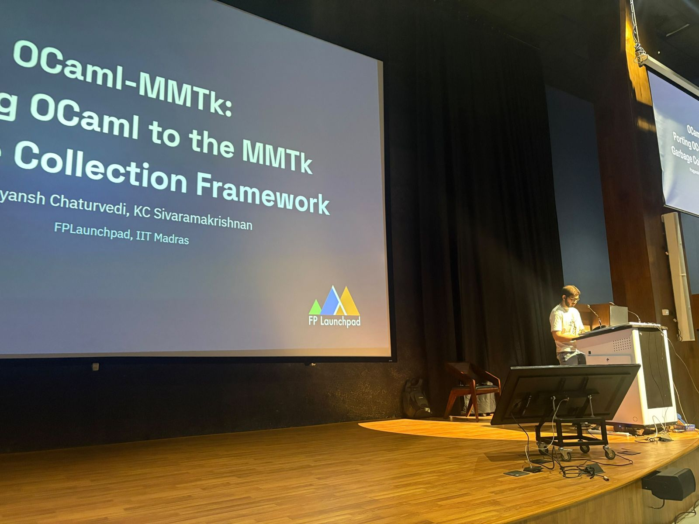
  <figcaption style="font-size:0.9em;color:#666;margin-top:0.4em;">Pragyansh presents OCaml–MMTk at IICT.</figcaption>
</figure>

The booth, in the AV Rama Rao Auditorium next to Google's, carried two A0 posters: one for FUN OCaml and one for the Post-Baccalaureate Fellowship.

<figure style="margin:1.5em 0;">
  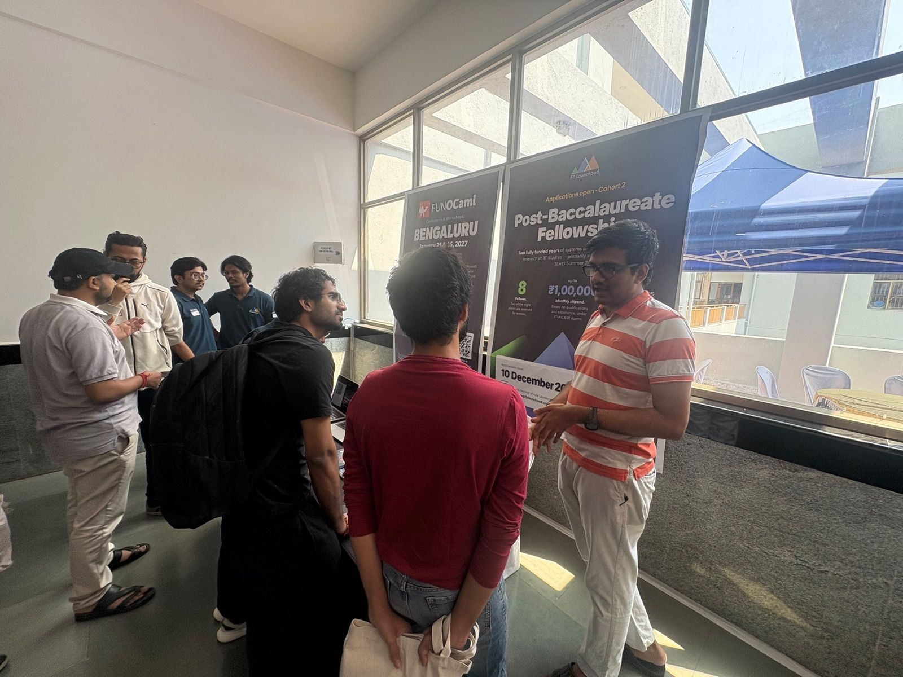
  <figcaption style="font-size:0.9em;color:#666;margin-top:0.4em;">Navaneeth walks visitors through the Post-Baccalaureate Fellowship at the IICT booth, while Durwasa, Vishakh and Sanjeev talk to visitors in the background.</figcaption>
</figure>

<figure style="margin:1.5em 0;">
  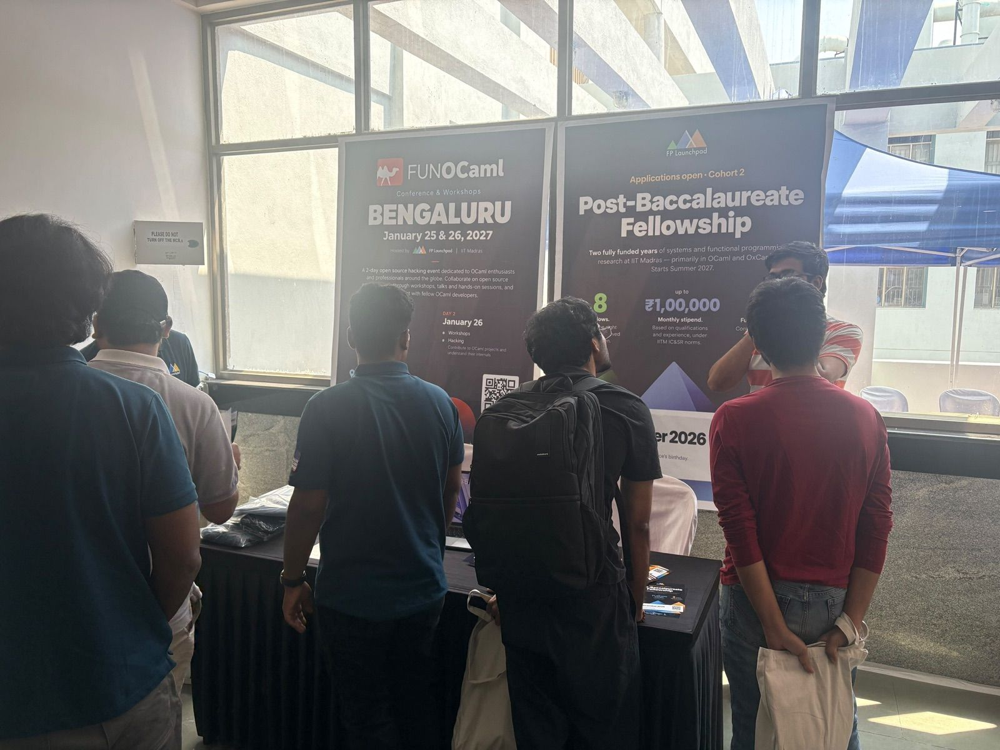
  <figcaption style="font-size:0.9em;color:#666;margin-top:0.4em;">The tea break crowd at the booth on the first morning.</figcaption>
</figure>

By the organisers' estimate, the team spoke to more than 200 people on the first day, nearly all of them working in compilers and programming languages. Many visitors were interested in working with us but unsure where to start, often because they had not written OCaml before. We pointed them to the [contributor interest form](https://fplaunchpad.org/work-with-us/) and [contact@fplaunchpad.org](mailto:contact@fplaunchpad.org).

<figure style="margin:1.5em 0;">
  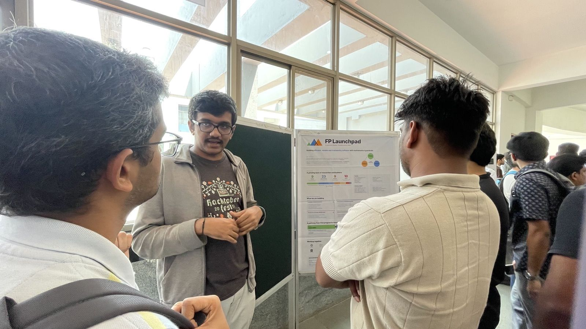
  <figcaption style="font-size:0.9em;color:#666;margin-top:0.4em;">On the second day, Navaneeth presents the "About FP Launchpad" poster: who we are, what we are building, and a pathway from first program to research.</figcaption>
</figure>

## Two hackathons

We sponsored two student hackathons. In both cases, we provided funding and the organisers ran the event.

### SEGFAULT

[SEGFAULT](https://segfault.compilertech.org/) is a compilers and programming-languages hackathon that ran online from 1 August, with its finale at IICT. We [announced our sponsorship]() in August, alongside [CDAC](https://www.cdac.in/), and functional programming was one of the eight open themes.

Of 41 projects evaluated online, nine reached the final at IISc. One was ours: Durwasa, Vimala and Vishakh entered as **soundnessAndSambar** with Tatami, built in OCaml and Lean 4. We funded the prizes for the two teams that shared third place: **decompiled_brain**, with qirc, and **pop rsp;ret**, with LLVM Lens.

### Syntax Error

In October, [SDSLabs](https://sdslabs.co/), the student technical group at IIT Roorkee, invited us to sponsor the 13th edition of their annual hackathon, [Syntax Error](https://hackathon.sdslabs.co/), held on 23–25 October; SDSLabs says it draws more than 2,000 students. We joined as [Gold sponsor](https://x.com/sdslabs/status/2113335419182182628), and SDSLabs added a [Functional Programming track](https://x.com/sdslabs/status/2113663484827422942) for students to "explore the intersection of mathematics and software by building innovative solutions using functional programming". We suggested a broad theme: AI, functional programming and formal verification for developing correct, efficient and reliable software. Winners and notable projects will be eligible for mentorship at FP Launchpad. Pragyansh, an IIT Roorkee alumnus, pointed us to the event, and we will share results when SDSLabs publishes them.

## Software for science

Our work with the [CoRE Stack](https://core-stack.org/) team on environmental planning tools is the main way we work with scientists today. Smayan reflected on this after an IndiaFOSS panel.

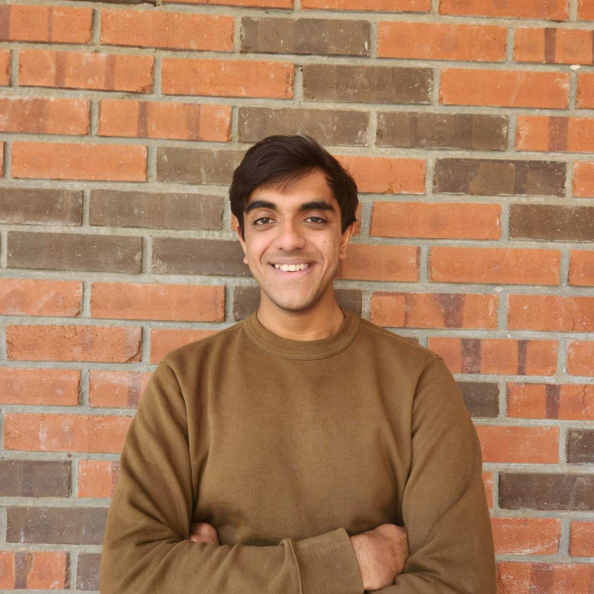 Smayan

> I want to talk a little bit about the excellent panel discussion I attended featuring Kailash Nadh, Harsh Nisar, Tarunima Prabhakar, and computational mama (Ambika). As someone who keeps up with twitter AI discourse to an unhealthy amount it was heartening to hear some truly fresh takes. It was obvious that the panelists had thought deeply about the impact of AI on the future of software and the software engineering community. But what was more surprising to me was the extremely sober takes that they had on AI use in government-tech and social impact-tech. It is not often that you hear engineers muse on the need to build slower and build only when necessary.
>
> A statement was made in that conversation that stuck with me: "be married to the problem, not the solution." I have been considering what that means in my own context. I have always seen myself to be a theory and math forward person. I used to justify this attitude to myself thinking that I would work solely on the problems that fit these methods. But my research at FPL really requires me to do otherwise. The problems I work on here concern climate change. They are important problems. They can't be solved using algebra and topology. I really must expand my own toolkit here to effectively be able to contribute to climate action.

### Healing Earth

On 11–12 September, Smayan, Kaustubh and [S Naveen](https://github.com/Sajjan-Naveen-87) (Exchange student) went to the [Healing Earth workshop](https://3cs.ashoka.edu.in/healing-earth-workshop), run by the Centre for Climate Change and Sustainability at Ashoka University. The first day covered the science of climate change and the second its policy and governance. [Prof. Aaditeshwar Seth](https://www.cse.iitd.ac.in/~aseth/), who leads CoRE Stack at IIT Delhi, spoke on the first day.

Kaustubh wrote up the science talks [on his blog](https://kaustubh.page/posts/healing-earth-workshop-ashoka-2026/). The workshop produced concrete next steps:

- A fortnightly call with Prof. Seth, to keep our [TESSERA](https://geotessera.org/) and testing work aligned with the CoRE Stack roadmap. Kaustubh and Prof. Seth agreed that CoRE Stack's data pipelines need many more sanity checks.
- An introduction, through Prof. Seth, to [Prof. Nipun Batra](https://nipunbatra.github.io/) at IIT Gandhinagar, who works on detecting brick kilns and the pollution they cause from geospatial data, and who thinks foundation models such as TESSERA now make that viable.
- Follow-up meetings between Smayan and Ashoka faculty Ghazala Shahabuddin, Meghna Agarwala and Gautam Menon, on use cases ranging from afforestation to hydrological data for mapping the risk of waterborne disease in Bengaluru.

Smayan found it hard to explain to ecologists what projects we could take on, and we plan to show results from TESSERA and CoRE Stack before asking again.

Separately, at a [PDGI](https://pdgi.org) workshop in Bengaluru, Kaustubh described our CoRE Stack collaboration to people from GramVaani, FOSS United, IT for Change, SAFAR, Tech4Good and the Pranava Institute. Several were interested in working together. Kaustubh has since worked with FOSS United, SAFAR and PDGI on their [call for public interest technologists](https://forum.fossunited.org/t/call-for-public-interest-technologists/9211), which aims to grow India's network of technologists working in the public interest.

### SciPy India

[SciPy India 2026](https://scipy.in/), the 14th edition of India's conference on scientific computing with open-source software, comes to IIT Madras on 19–20 December. It is incubated by [FOSS United](https://fossunited.org/), whose CEO, [Sai Rahul Poruri](https://fossunited.org/u/rahulporuri), is a friend of FP Launchpad and an IIT Madras alumnus. Rahul told us the conference was coming to our campus and encouraged us to take part, as a way to meet researchers who write Python. The [call for proposals](https://cfp.scipy.in/scipy-india-2026/) closed on 1 November, and three of the team submitted:

- [Vipul Cariappa](https://vipulcariappa.xyz/) (Fellow), on [cppyy](https://cppyy.readthedocs.io/), the automatic Python and C++ bindings Vipul worked on at CERN; see also Vipul's [LLVM Social talk on C++ interop](/updates/#talk-how-to-interoperate-with-c-by-using-the-compiler-as-a-service).
- Pragyansh, on using a neural network as a Linux kernel scheduler, straight from a Jupyter notebook, by extending [PythonBPF](https://github.com/pythonbpf/Python-BPF) to support the kernel's extensible scheduler class, sched_ext.
- Kaustubh, on automatic data validation, from our work on the [CoRE Stack backend](https://github.com/fplaunchpad/core-stack-backend).

The proposals are in review.

## Joining FP Launchpad

Alina, Vimala and Kaustubh all came back with conversations about the fellowship, and at least one workshop participant has since contacted us about joining.

- The [Post-Baccalaureate Fellowship, Cohort 2]() offers two fully funded years of systems and functional programming research at IIT Madras. Applications close on **10 December 2026**.
- People who cannot move to Chennai can contribute part-time through our [contributor interest form](https://fplaunchpad.org/work-with-us/).
- On campus, Smayan runs [OCaml Practice Thursdays](https://docs.google.com/forms/d/e/1FAIpQLSffQC6TP2pET4ozwZrWjU1ES1_EkAh2_T-pt2Wuja4QIcqdCQ/viewform), a weekly session for working through short, hard problems in OCaml, open to anyone at IIT Madras with some OCaml experience.

All of the code linked above is open, and most of these projects welcome contributors. Our [Updates page](/updates/) lists recordings and slides from earlier talks and seminars.

  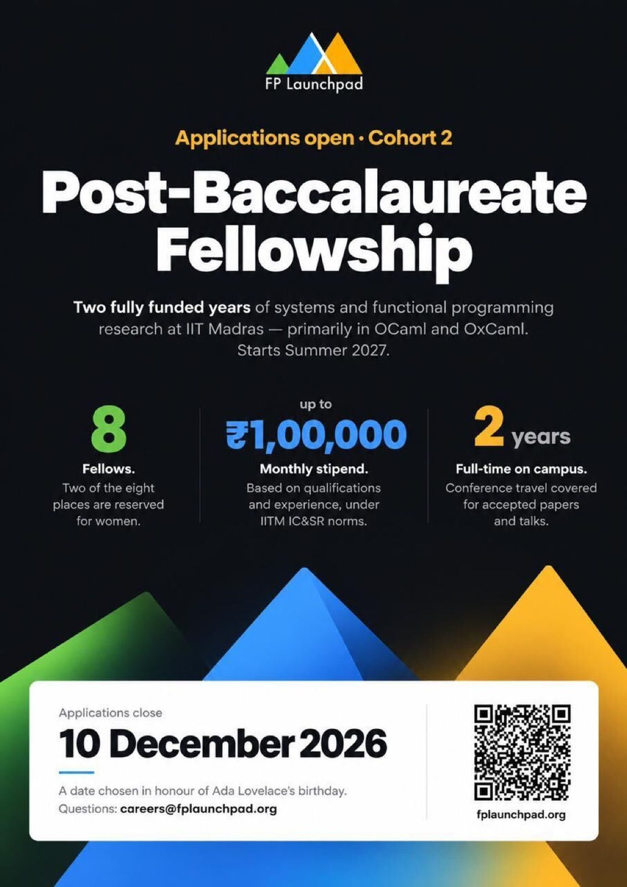
  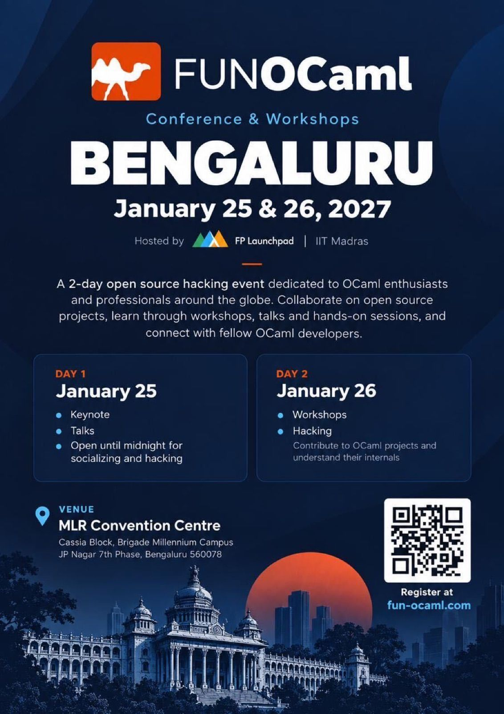

## Looking ahead

Our [Programming Languages Winter School](https://fplaunchpad.org/winter-school-2026/) runs from 7 to 11 December in Turing Hall, Dept of CS, IIT Madras. Later that month, we will be at SciPy India on 19–20 December.

[FUN OCaml](https://fun-ocaml.com/) comes to the MLR Convention Centre in Bengaluru on **25–26 January 2027**, the first FUN OCaml in India, which we are organising with [Ashutosh](https://www.linkedin.com/in/ashupdsce/) as our point person in Bengaluru. The first day has a keynote and talks, with the venue open until midnight for socialising and hacking; the second day has workshops and hands-on hacking on OCaml projects. [Tickets](https://conf.code.iitm.ac.in/conf/Fun_OCaml_2027/login) are open to students and developers at every level, and you do not need a talk to attend.

If you met us at one of these events, we would like to hear from you at [contact@fplaunchpad.org](mailto:contact@fplaunchpad.org). For news of future events and openings, join our [Zulip](https://fplaunchpad.zulipchat.com/join/xc4hb7eprn2xidfgpkamor5q/) or follow us on [X](https://x.com/fp_launchpad) and [LinkedIn](https://www.linkedin.com/company/fp-launchpad/).

We thank [Ashutosh](https://www.linkedin.com/in/ashupdsce/) and the IICT and SEGFAULT volunteers, FOSS United and the IndiaFOSS organisers, SDSLabs, and CDAC.
